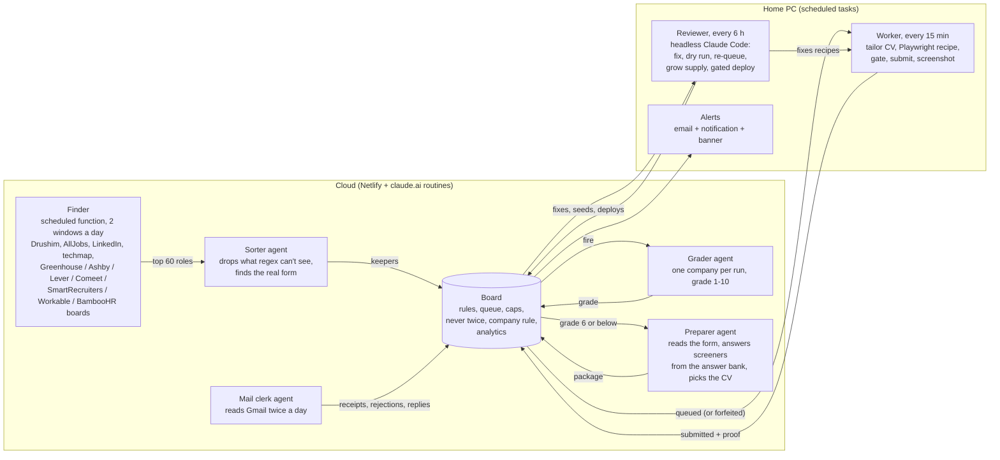

# Job Pipeline: an autonomous interview-generating machine

A closed loop that finds fitting job postings every night, grades each company with AI agents, prepares every application, submits it through the company's real form with Playwright, proves it went through by reading the receipt in Gmail, and fixes its own failures every six hours.

I built it for my own job search in Israel in October 2026. Its purpose is interviews: it turns my time into reps by sending well-targeted practice applications while I spend my own hours on the seats I really want. Every application goes out exactly the way I would have sent it myself: the right CV for the posting with the posting's exact title on it, my own answers from my answer bank, every field filled correctly, never a half-filled form. Just automatically, in a closed loop, and tested.

**Status, as of 27 Oct 2026:** running unattended every day. In the last 7 days the hunt kept 96 roles, 87 were queued and 62 were sent. 73% of the sent ones have an email receipt on file. 9 rejections by 26 Oct (all templates), 0 interviews so far. The board held 47 application records by 25 Oct. It is set to send 10 a day.

I designed the architecture, the flows and every rule here, and built it with Claude Code as my pair.

## The loop



## How it works

### 1. The nightly hunt
A Netlify scheduled function runs every 5 minutes inside two windows a day (00:00-01:55 and 11:00-12:55 UTC), one step per tick. It reads Drushim and AllJobs (the two big Israeli job sites), LinkedIn's logged-out search (usually refused from a cloud address), techmap (an open daily list of Israeli tech jobs) and every company job board on its seed list through the public ATS APIs. Cheap rules run first with no LLM: title words in English and Hebrew, seniority, Israel, agencies, stale postings, and anything the board already knows. Recent runs saw 1,100 to 3,300 roles each. The top 60 go to the sorter.

### 2. The sorter finds the real form
One agent run a night. It drops what a script cannot see (a sales quota seat with an engineer title, a staffing agency, a language requirement, hidden seniority) and finds where you would actually apply: the posting's own Greenhouse, Lever, Ashby, Comeet or SmartRecruiters form behind a LinkedIn or Drushim listing. It sends back at most 25, at most 2 per company.

### 3. AI grading of each company
One grader run per company: 3 to 6 sources in about 3 minutes, a grade from 1 to 10 against my profile and goals. Who I know there must not move the grade. Above 6 is a real lead: the system never applies there, it is left for me. 6 or below is the practice tier.

### 4. Per-role prep
One preparer run per role. It reads the form through the ATS's public data, lists every field and screener, answers screeners only from my answer bank, picks the CV master and records the posting's exact title. It never logs in and never types into a form.

### 5. Queue or forfeit
The board decides at prep time. A card with a recipe for its ATS, no open screener and no flag is **queued**. Anything else is **forfeited** with the reason on the card: no recipe, LinkedIn-only, a captcha, a login wall, a question the answer bank cannot answer. Rules in code: one application per role ever, and the **company rule**: at most 2 open applications per company, one role family only (product, engineering or solutions).

### 6. The right CV, tailored per posting
Four master CVs live in a separate CV project; the preparer picks one of the three that fit practice-tier seats (AI / solutions / software engineering, founding engineer at a tiny startup, or product) by title. The worker calls the CV tool to stamp the posting's exact title into it and print a one-page PDF. Over one page means a shorter title or a failed card, never a two-page CV. No keyword stuffing, no cover letters.

### 7. The PC worker submits
A Windows scheduled task every 15 minutes. It claims up to 3 queued cards from the board (atomically, inside the daily and hourly caps), attaches to a real Chrome profile over CDP on my home connection, and runs the recipe for that ATS: **Comeet, Greenhouse, Lever, Ashby, SmartRecruiters, Drushim, AllJobs, Workable, BambooHR**. Identity comes from a local config file, screener answers from the card. Before every click a gate reads every required field on the page and refuses to submit if one is empty. **Never a half-filled form.** An unknown control or an unanswered question stops the card; nothing is guessed. Captchas are never solved.

### 8. Proof by the mail clerk
After the click the worker waits for the site's own confirmation and saves a screenshot of it (`submitted`). Twice a day the mail clerk agent reads Gmail read-only, files receipts (`confirmed`), rejections (the role closes) and replies (a task appears on the board). A sent card with no receipt after 3 days, or an unknown outcome after the click, becomes `unverified` and is never retried: applying twice is worse than missing one.

### 9. Analytics
Four stage rates, each with an owner of the fix: kept -> queued (finder, answer bank, briefs), queued -> sent (recipes, worker), sent -> receipt (mail clerk), sent -> interview (CV, targeting, grade). Last 7 days to 27 Oct: **91% / 71% / 73% / 0%**. The queued -> sent dip that week has two causes in the log: 9 cards waiting for the next day's cap and 11 lost to a rate limit, fixed the same day.

### 10. Monitoring and alerts
Every board function emits structured events; a collector on the PC pulls them into SQLite with the worker's evidence (screenshots, form snapshot with the source of every value, Playwright trace, CV hash). After every tick an alert check looks for the things that silently stop the loop: board down, agents unable to fire, hunt missed, roles stuck ungraded, mail clerk silent, reviewer silent, Netlify credits running out, supply stalled. Each new problem sends one email, a Windows notification and a red "Needs you" banner on the board.

### 11. The reviewer: the loop fixes itself
Headless Claude Code runs every 6 hours with a standing prompt. It reads what failed since the last run, finds the cause in the logs, screenshots and traces, fixes the recipe, filter or brief, proves the fix with a dry run on the real form (fills everything, never clicks), and re-queues the card if nothing was sent. It grows supply (probes and adds company boards, sweeps techmap's ~7,950 Israeli companies for new ones), builds a new recipe when an ATS without one reaches 3 fitting open roles, raises caps after two clean nights, and writes a digest. Its limits live in its tools, not its prompt: the dry-run tool cannot click, the re-queue tool refuses unverified cards, the caps tool has ceilings, and the deploy script is the only way to ship.

### 12. Deploy gating under Netlify credits
Every production deploy costs 15 of 300 credits a cycle. The deploy script refuses an uncommitted tree, runs every test suite on a local board it starts itself, checks the credit budget (at most one deploy per 24 hours, a reserve of 60), deploys, then probes the live site for lost writes and checks the agents can be fired. Rollback is free.

### 13. Rate limit backoff
A 429 from the agent trigger pauses all firing until the time the error names, without using the card's attempt; the worker's next claim resumes the chain.

### Daily volume
The daily volume is a setting you can turn to any number. The only real ceiling is supply: enough fitting postings found by the hunt. I run it at 10 a day.

### What the human does
Nothing, except leaving the computer on and plugged in. When a form asks a question my answer bank has no answer for, the card is forfeited and the board (and an email) asks me for the answer once; after that the reviewer re-queues it. Rarely, an alert asks for something only I can do: signing in to a job site again after a Chrome restart, or a call on Netlify credits.

## Tech stack
- Node.js 22 (ES modules), plain JavaScript
- Netlify Functions (including scheduled functions), Netlify Blobs, a static single-page board (vanilla JS, no framework)
- Claude agents as claude.ai routines (sorter, grader, preparer, mail clerk, lessons), fired by API with structured JSON callbacks
- Claude Code headless (`claude -p`) for the scheduled reviewer and for alert emails through the Gmail connector
- Playwright over CDP into a real Chrome profile
- SQLite (`node:sqlite`) for the event store
- Windows Task Scheduler, PowerShell, cmd

## Engineering decisions and tradeoffs
- **Playwright on a real Chrome profile over CDP, not a browser agent and not headless.** A browser extension agent could not see one ATS's form at all and asks a human before every submit. Headless browsers trip bot detection. A real profile on a home IP, driven by deterministic recipes, is boring and reliable.
- **Recipes per ATS instead of a general AI form filler.** Nine recipes cover the forms that matter in this market. Each one knows its ATS's quirks and has a gate. An AI filler would be more general and much harder to prove correct.
- **Scripts for what scripts can do, agents only for judgment.** The finder, the rules, the queue and the submit are code. The agents sort, grade, read forms and read mail.
- **Forfeit instead of park.** Hands-off means a card that cannot be submitted automatically is dropped with a reason, not left waiting for me. The reviewer and the analytics turn the reasons into fixes.
- **Never twice beats coverage.** An unknown outcome is `unverified` forever, not retried.
- **Answers only from the answer bank.** The system never invents a fact about me; an unknown question costs a card, not my credibility.
- **Limits in code, not prompts.** The reviewer has a wide mandate, so its tools carry the ceilings and refusals.
- **One agent job at a time.** Simple to reason about; the trigger has a rate limit anyway.
- **Full-document saves with conflict detection** instead of a database: one JSON state document in Netlify Blobs, a stamp chain plus re-read, 409 on a lost write, every writer retries.
- **Rejected:** automating my LinkedIn account, Easy Apply, creating accounts on portals like Workday, solving captchas, generated cover letters. Each is either against a site's rules, a risk to my real accounts, or a place where untrue things creep in.

## The road here
Two weeks from a manual CRM to hands-off: a plan and a first submit (14-15 Oct), the night chain live in the cloud (16-19 Oct), hands-off with the PC worker (19-21 Oct), measuring and the self-improving reviewer (21-22 Oct), volume and a Netlify credit wall (23-25 Oct), then supply (26-27 Oct).

Real problems hit along the way, all in [docs/journey.md](docs/journey.md) with their fixes: LinkedIn-only postings and careers pages answering 403 to a server; hCaptcha on every Lever form; a job site that silently sent nothing because a panel mode was never picked; sessions dying on a Chrome restart; the mail clerk running only some days and making the receipt rate look broken (14% -> 59% after one catch-up run); a hidden lost write in the state store (10 of 15 probes failed, then 0); a night hunt that never finished because it resolved one row at a time; roles stuck ungraded after the Netlify account ran out of credits; a 429 that burned 11 cards in one second.

Lessons, short: proof is a scheduled run on a real card, never a manual one; silent failures are the expensive ones; measure each stage separately; the pre-click gate is the most valuable code in the worker; platform limits break more than your own code; once the recipes work, supply is the ceiling.

Architecture in detail: [docs/architecture.md](docs/architecture.md).

## What is tested, exactly
- **Board: 10 suites, 372 checks** (counts from the last gate run, 27 Oct 2026). Five run against a local board (`netlify dev` plus `tests/fire-catcher.mjs` standing in for the agent trigger): `obs` 57 (every write emits events, the collector ingests them, conflicts lose nothing), `handsoff` 67 (auto-queue, forfeits, atomic claims, caps, never twice per role, sweeps, seeds, title keys), `chain` 53 (finder -> grader -> preparer, deny lists, ledger, mail hook), `sorter` 20, `feed` 10. Five are pure unit tests: `titles` 66, `prefilter` 35, `techmap` 27 (on a real 50-row fixture), `company-rule` 24, `rate-limit` 13.
- **Worker: 3 suites, 63 checks**, pure: `reviewer/discover` 39 (board discovery classifier, supply score and stall rules), `linkedin-feed` 14, `reviewer/credits` 10 (deploy credit gate).
- The 8 pure suites were re-run on this exact public copy before the commit: all green.
- `tests/cas-probe.mjs` runs against the live site after every deploy (concurrent saves must never both win).
- **Not covered by automated tests: the Playwright recipes against live ATS forms.** Those are verified another way: `worker/dry-run.mjs` runs a recipe on a real posting up to the gate and never clicks (every recipe fix is dry-run before it ships, plus a regression dry run on another ATS); every live send saves a filled-form screenshot before the click and the site's confirmation after it; the receipt in Gmail is the final proof. A recipe counts as proven only after a scheduled tick lands a real submission.

## Running it locally
Requirements: Node 22+, Windows for the worker's scheduled tasks (the code itself is cross-platform), Chrome, a Netlify site, two claude.ai routines.

```bash
# board
cd board && npm install
cp ../.env.example .env            # fill in placeholders: PIPELINE_KEY, RESEARCH_SECRET, ROUTINE_FIRE_URL, ROUTINE_TOKEN, ...
node tests/fire-catcher.mjs &      # stands in for the agent trigger on :8898
ROUTINE_FIRE_URL=http://localhost:8898/fire ROUTINE_TOKEN=local-test npx netlify dev --port 8899 --offline
node tests/handsoff.test.mjs       # and the other suites in board/tests

# worker
cd worker && npm install && npx playwright install chromium
cp config.local.example.json config.local.json                 # your identity (placeholders: Jane Doe)
cp reviewer/board-site.example.json reviewer/board-site.json   # your Netlify site, only for the deploy gate
start-chrome.cmd                                               # sign in once in the runner profile
node dry-run.mjs --url <a real posting> --ats greenhouse       # fills, attaches, gates, never clicks
powershell -ExecutionPolicy Bypass -File install-task.ps1      # the 15-minute worker task
```

Env vars (names only, see `.env.example`): `PIPELINE_KEY`, `RESEARCH_SECRET`, `ROUTINE_FIRE_URL`, `ROUTINE_TOKEN`, `MAIL_FIRE_URL`, `MAIL_TOKEN`, `NETLIFY_AUTH_TOKEN`. Optional on the PC: `ALERT_EMAIL`, `CLAUDE_CLI`, `APPLY_PROFILE`, `APPLY_CHROME`, `APPLY_CDP`, `OBS_DB`, `BOARD_DIR`, `BOARD_REPO`.

Agent setup: paste `board/ROUTINE-PROMPT.md` and `board/ROUTINE-MAIL-PROMPT.md` into two claude.ai routines, fill in your own profile in `board/research-brief.md`, and push your answer bank (template in `examples/answer-bank.example.md`) to the board's settings. The CV tool the worker calls (`cv.js tailor`) is a separate project and not included; any CLI that writes `<cvsDir>/<company>/CV.pdf` works.

The hunt is tuned for Israel (Hebrew titles, Israeli job sites, Israel location rules). Company names in code comments and test fixtures are fictional placeholders; the real ones stay private.

## Repo layout
```
board/     Netlify site: app.js + index.html (the board), netlify/functions (state, hunt, hunt-find, mail, record, research, lessons, obs),
           agent briefs (*-brief.md), routine prompts, tests/, tools/
worker/    PC worker: worker.mjs, recipes/ (one per ATS), lib/ (board client, browser, forms, find-form, obs), alerts.mjs,
           reviewer/ (scheduled reviewer prompt + its tools: dry runs, caps, seeds, discover, supply, deploy gate, credits)
obs/       SQLite event store: collector, schema, views, CLI
docs/      architecture.md, journey.md
examples/  answer-bank.example.md
```

## Status and what's next
Running daily since 21 Oct 2026, fully hands-off since then. Next: the first interview from a loop-sent application (the whole point, not there yet), a first live Lever submit that is not challenged by hCaptcha, automated guesses at why each rejection happened, and weekly outcome learning by CV master, title, grade and ATS.

## License
MIT, see [LICENSE](LICENSE).
